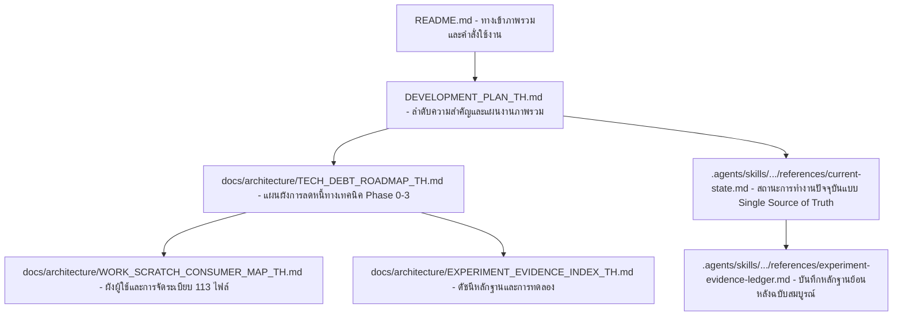

# ดัชนีหลักฐานและการทดลองของโครงการ (Experiment & Evidence Index)

ปรับปรุงล่าสุด: 2026-09-11
เอกสารนี้เป็นสารบัญหลัก (Canonical Index) เชื่อมโยงทุกหมุดหมาย, การทดลอง, กลไก, คำตัดสิน (Verdict), รหัส Commit และ Artifacts ที่ถูกตรึงถาวรใน ThaiMakhosEngine เพื่อให้ค้นหาและสอบทานย้อนกลับได้โดยไม่ต้องคัดลอกรายงานซ้ำซ้อน

---

## 1. ตารางสรุปหมุดหมายและการทดลองหลัก

| หมุดหมาย / การทดลอง | กลไก / ขอบเขต | คำตัดสิน (Verdict) | หลักฐาน / Checkpoint / Artifact | เอกสารอ้างอิงหลัก |
|---|---|---|---|---|
| **กติกาและ Native Core พื้นฐาน** | C17 Bitboard, Perft depth 10, Differential tests | **ACCEPTED** | DLL: `build/makhos_native_accepted.dll` SHA: `FEEDD39CF16E5F5ABC236452BE897ABE1ECF26B8BA7ADCDA4A25022B868C3DDD` | [`VERIFICATION.md`](../../VERIFICATION.md) |
| **Tablebase 3–6 ตัว (Compact np80)** | Exact WDL solver, Compact threshold compression | **VERIFIED / COMPLETE** | TB4: `build/tb4_np80.compact.bin` TB5: `build/tb5_np80.compact.bin` TB6: `build/tb6_np80.compact.bin` Provenance: `TABLEBASE_PROVENANCE.json` | [`README.md`](../../README.md), [`TABLEBASE_PROVENANCE.json`](../../TABLEBASE_PROVENANCE.json) |
| **NNUE v1 Feature Spec & Data** | `thai-makhos-shared-137-v1`, 50k games, sealed test split | **FROZEN / PASS** | Spec: `makhos/nnue_features.py` Attestation: `releases/nnue-v1-20260908/promotion_attestation.json` | [`NNUE_ROADMAP.md`](../../NNUE_ROADMAP.md) |
| **NNUE v1 Gates A & B** | Bit-exact scalar/AVX2/incremental, overflow proof | **PASS** | Model: `build/nnue_quantized_v1/model_a.mknnue` SHA: `07B9AB0F83E253CB74B2ACD2BD5291F5F91EB086E042790F33EA0A8C0914164C` | [`NNUE_ROADMAP.md`](../../NNUE_ROADMAP.md) |
| **NNUE v1 Gate C (SPRT vs HCE)** | 1.0s และ 2.0s STC vs HCE baseline (+80 Elo) | **FINISHED_PASS** | Checkpoint: `build/nnue_gate_c_1000ms_seed20261105.json` (LLR +2.946) | [`references/experiment-evidence-ledger.md`](../../.agents/skills/thai-makhos-engine/references/experiment-evidence-ledger.md) |
| **NNUE v1 Production GUI Release** | GUI default profile = NNUE v1 (12T / 512 MiB TT) | **PROMOTED** | Release manifest: `releases/nnue-v1-20260908/manifest.json` Pointer: `config/gui_release.json` | [`DEVELOPMENT_PLAN_TH.md`](../../DEVELOPMENT_PLAN_TH.md) |
| **Phase 4: Thread-Scaling Audit** | การวัดสเกล 1, 2, 4, 6, 8, 12T (5,760 observations) | **COMPLETE_DIAGNOSTIC** | Report: `build/nnue_thread_scaling_measured_v1/report.json` ข้อค้นพบ: Branch starvation + SMT saturation บน 6 cores | [`DEVELOPMENT_PLAN_TH.md`](../../DEVELOPMENT_PLAN_TH.md) |
| **Endgame Search C1–C4** | C1 (TB3 memory), C2 (TB4-6 stream), C3 (Ranked), C4 (Root split partition + shared mmap) | **PROMOTED** | DLL: `build/native_endgame_c4/makhos_endgame_search_nnue.dll` SHA: `D736F05906FD15F2BF18E9EC88BDF8898C844B35F4971E626572A71B88EF00B5` | [`docs/architecture/ENDGAME_NATIVE_PHASE1C_TH.md`](ENDGAME_NATIVE_PHASE1C_TH.md) |
| **Endgame Transition Coverage (PR #6)** | Correctness: Multi-captures จาก >6 เข้าสู่ <=6 ตัว | **MERGED (Correctness Exception)** | Commit: `e975d6843ee23e9fe42a3662f5d802516293796e` Windows full suite 513/513, Node 16/16 PASS | [`docs/architecture/ENDGAME_TRANSITION_COVERAGE_TH.md`](ENDGAME_TRANSITION_COVERAGE_TH.md) |
| **Experiment A (6T vs 12T SPRT 1000ms)** | ทดสอบสมมติฐาน 6T เหนือกว่า 12T หรือไม่ (539 คู่, 1,078 เกม) | **INCONCLUSIVE / REJECT 6T** | 27-pair Checkpoint SHA: `09cffee749b485c1a742f921d89a173c86defbd5f15bc1a7f1f2a1b84b3de06f` 539-pair Checkpoint SHA: `66d67efc5ec10ab60f19ff1ef24789ec212c69de8e6d2d7f8400846471cb0c9c` ผล: 12T แข็งแกร่งกว่า 6T (-9.67 Elo), คง 12T เป็นค่าเริ่มต้น | [`references/current-state.md`](../../.agents/skills/thai-makhos-engine/references/current-state.md) |
| **Tech Debt Phase 0 (PR #7)** | Roadmap, Inventory, SKILL.md complexity gates | **MERGED** | Commit: `738cb7cfc350ed1fd606a45ebe05b22589ad3d5b` Inventory: `tech_debt_inventory_20260911.json` | [`docs/architecture/TECH_DEBT_ROADMAP_TH.md`](TECH_DEBT_ROADMAP_TH.md) |
| **Tech Debt Phase 1A (PR #8)** | Consumer & evidence mapping 113 tracked files | **MERGED** | Commit: `e8f7e90e3ca05b80b11506be95d3e22d9af023cd` Mapping JSON: `work_scratch_consumer_map_20260911.json` | [`docs/architecture/WORK_SCRATCH_CONSUMER_MAP_TH.md`](WORK_SCRATCH_CONSUMER_MAP_TH.md) |
| **Tech Debt Phase 1B Cluster 1 (PR #9)** | Relocation: Attestation & Production Smoke | **MERGED** | Commit: `36cc8afc445d37e7ed534219ab82fa08dee90580` Canonical: `tools/verification/full_suite_attestation.py` | [`docs/architecture/TECH_DEBT_ROADMAP_TH.md`](TECH_DEBT_ROADMAP_TH.md) |
| **Tech Debt Phase 1B Cluster 2 (PR #10)** | Relocation: SPRT Arena & Telemetry Audit tools | **MERGED** | Commit: `c80b0c6ea1bf836e540862c510f09ce5032ff601` Canonical: `tools/arena/`, `tools/verification/` | [`docs/architecture/TECH_DEBT_ROADMAP_TH.md`](TECH_DEBT_ROADMAP_TH.md) |
| **Tech Debt Phase 1B Cluster 3 (PR #11)** | Migration: Tooling Tests to `tests/tooling/` | **MERGED** | Commit: `3308d4a2e12d5b6a483491f7b519a4909a32a224` Full suite: 571/571 PASS, Wrappers: 55/55 PASS | [`docs/architecture/TECH_DEBT_ROADMAP_TH.md`](TECH_DEBT_ROADMAP_TH.md) |

---

## 2. แหล่งข้อมูลที่ไม่เปลี่ยนแปลง (Immutable Invariants)

| รายการ | SHA-256 Digest | หน้าที่ / บทบาท |
|---|---|---|
| `RULESET.json` | `77528addc0e08b17217346c511c7c4084bad4af48789955c3ec85ef76a64871f` | กติกามาตรฐานหมากฮอสไทย ห้ามแก้ไข |
| `makhos/core.py` | `03152e513bd360e6c2c97ecdf08dc58a290dca0ae6e28889ae70585a381292ab` | Reference rules implementation ของโครงการ ห้ามแก้ไข |
| `build/makhos_native_accepted.dll` | `feedd39cf16e5f5abc236452be897abe1ecf26b8ba7adcda4a25022b868c3ddd` | Accepted control binary ห้ามเขียนทับ |
| `build/nnue_quantized_v1/model_a.mknnue` | `07b9ab0f83e253cb74b2acd2bd5291f5f91eb086e042790f33ea0a8c0914164c` | โมเดล NNUE v1 ที่ใช้งานจริงใน GUI |
| `build/nnue_sprt_6t_vs_12t/sprt_6t_vs_12t_1000ms_seed20261108.json` | `09cffee749b485c1a742f921d89a173c86defbd5f15bc1a7f1f2a1b84b3de06f` | Checkpoint ประวัติศาสตร์ 27 คู่ (pre-C4) |
| `build/nnue_sprt_6t_vs_12t_c4_v1/sprt_6t_vs_12t_1000ms_seed20261108.json` | `66d67efc5ec10ab60f19ff1ef24789ec212c69de8e6d2d7f8400846471cb0c9c` | Checkpoint 539 คู่ C4 (INCONCLUSIVE / 12T superior) |

---

## 3. แผนที่การนำทางเอกสาร (Documentation Navigation Map)

---

## 4. ลำดับความสำคัญของเอกสาร (Document Authority Order)

เมื่อพบข้อความหรือตัวเลขที่ขัดแย้งกันในคลัง ให้ยึดลำดับสิทธิตาม `.agents/skills/thai-makhos-engine/SKILL.md`:
1. คำสั่งล่าสุดและเป้าหมายที่ผู้ใช้ระบุโดยตรง
2. Invariants ของ SKILL.md และบันทึกใน `current-state.md`
3. `DEVELOPMENT_PLAN_TH.md`
4. `NNUE_ROADMAP.md`
5. `references/experiment-evidence-ledger.md`
6. เอกสารประวัติศาสตร์และ Roadmap อื่น ๆ\n