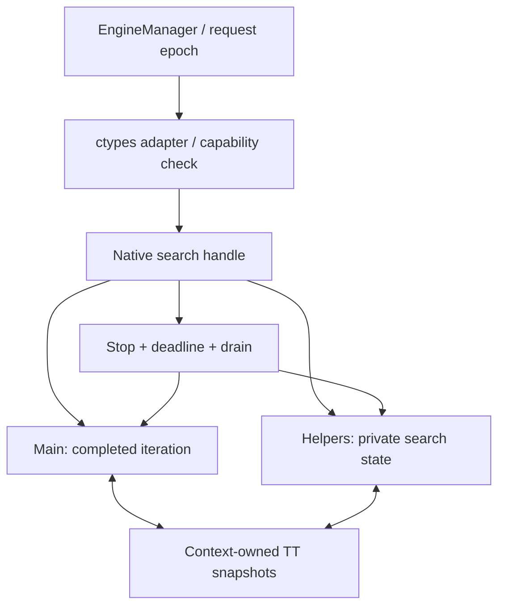
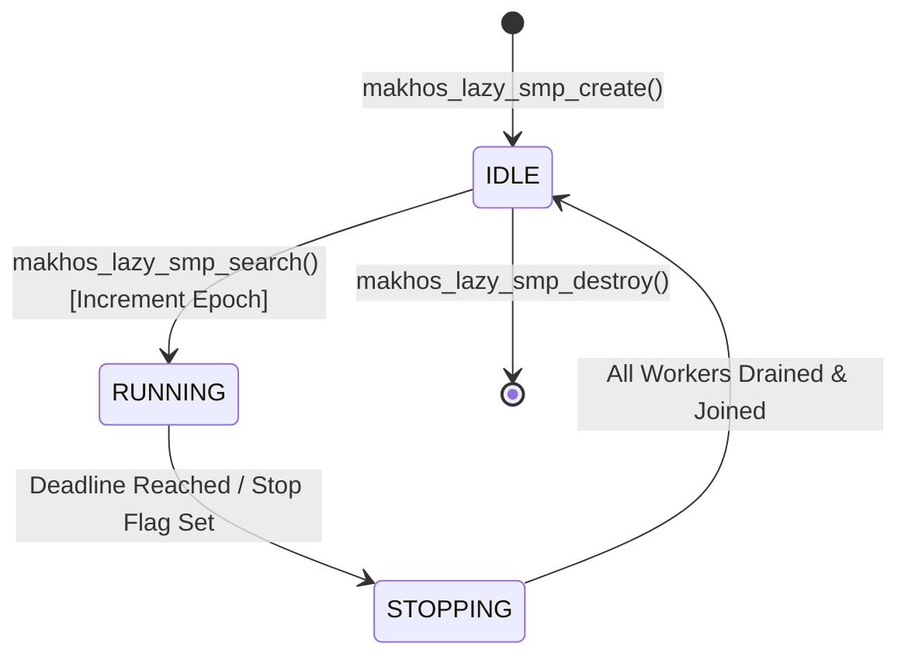

# Native Shared-TT Lazy SMP — ฉบับทบทวนและการปิดข้อกำหนดการออกแบบ (P0 Resolved)

วันที่ทบทวนและปิดข้อกำหนด: 2026-09-12 · Source: `a0f79645d9803680a6aa42ae910d49dee1d89f52` (Merge PR #17)

สถานะ: **DESIGN ACCEPTED (P0 RESOLVED) — อนุมัติการออกแบบเฉพาะ Move-Hint Sharing; ส่วน Shared-Score Alpha-Beta Cutoff ถูกกำหนดเป็น `BLOCKED_SCORE_SHARING`**
เอกสารฉบับนี้บันทึกข้อสรุปและการปิดข้อกำหนด P0 ครบทั้ง 5 ด้านตามผลการทดสอบ race harness จริงบน Windows x64 และการวิเคราะห์ทางทฤษฎีเกมกติกาหมากฮอสไทย เพื่อให้พร้อมนำไป implement อย่างปลอดภัย โดยยังไม่กระทบ production release pointer เดิม

## 1. สรุปการปิดข้อกำหนด P0 (Resolution Summary)

| หัวข้อ P0 | ปัญหาเดิม | ข้อยุติและหลักฐานตรวจรับ (Resolution & Verdict) | สถานะ |
|---|---|---|---|
| **P0-A: Publication Protocol** | คิดว่า aligned 64-bit หรือ XOR key พอป้องกัน torn read ของ 40B entry | ออกแบบ 48-byte Lock-free Sequence Counter protocol (C11 `stdatomic.h`); พิสูจน์บน Windows LLVM Clang ด้วย `tests/native_protocol_test.c` (8 writers + 4 readers, 1.2M ops) ได้ **0 torn reads** | **CLOSED / VERIFIED** |
| **P0-B: Score Admissibility** | คิดว่า key ตรงกันแล้วใช้ score ตัดกิ่งได้ | พิสูจน์แล้วว่า Reversible Clock (กติกา 80 ตา) และ In-line Repetition Cycles (H1→H2→H1) ทำให้ helper score นำมาตัดกิ่งข้ามเส้นทางค้นหาไม่ได้โดยปราศจาก full history proof จึงกำหนดสถานะเป็น **`BLOCKED_SCORE_SHARING`** (อนุญาตเฉพาะ Move Ordering Hints) | **RESOLVED (MOVE-ONLY RULE)** |
| **P0-C: Caller / API Contract** | เสี่ยงส่ง handle สับสนกับ `NativeSearchContext*` และ model binding ไม่ชัดเจน | กำหนด Caller Compatibility Matrix ชัดเจน; แยก entrypoint `makhos_lazy_smp_*`; ตรึง immutable NNUE weights และ private accumulator ต่อ worker; Thread 0 เป็นผลลัพธ์ทางการ | **CLOSED / SPECIFIED** |
| **P0-D: Lifecycle & Ownership** | เสี่ยง resource leak, partial thread fail, race ตอนหยุด | กำหนด State Machine ชัดเจน `IDLE -> RUNNING -> STOPPING -> IDLE`; monotonic deadline; drain-before-free ownership table; ห้ามใช้ `TerminateThread` | **CLOSED / SPECIFIED** |
| **P0-E: Complexity Control** | กฎ diversification และ helper voting ซับซ้อน | ปฏิเสธ helper voting/deepest-worker election โดยสิ้นเชิง; ตรึง Thread 0 เป็น sole authority; กำหนด deterministic diversification เพียงกฎเดียวต่อ worker | **CLOSED / SPECIFIED** |

## 2. หลักฐานและสมมติฐาน

ข้อเท็จจริงจาก [parallel_native.py](../../makhos/parallel_native.py): root split
แบ่งงานตาม legal root moves และยอมรับ common completed layer ก่อนเปลี่ยน depth.
ด้วย legal moves น้อยกว่าจำนวน worker อาจใช้ worker ไม่ครบ แต่ช่วง idle 30–75%,
ตัวเลข nodes/depth และ effective 3.7T ในข้อเสนอ **ยังไม่ใช่ผลที่ตรวจซ้ำในรอบนี้**.
ต้องแนบ profile ต้นฉบับพร้อม corpus/source/DLL/model SHA, time budget,
requested/effective Threads/Hash, cold/warm, repetitions และ workload isolation
ก่อนใช้ตัวเลขดังกล่าวเป็น baseline ของ candidate

[ctypes.CDLL](https://docs.python.org/3/library/ctypes.html#ctypes.CDLL)
ปล่อย GIL ระหว่างเรียก C อยู่แล้ว และ [native.py](../../makhos/native.py) ใช้ CDLL.
single search call ลดการประสานงาน/แปลงข้อมูลหลายครั้งได้ แต่ Python validation,
queue/lock wait, setup, marshalling และ response ยังมีอยู่ ต้องวัดแยกกัน

Hypothesis ที่ตรวจหักล้างได้: native workers ที่มี private search state และ
shared TT ที่อ่านได้อย่างปลอดภัย จะช่วย authoritative main ได้มากกว่าต้นทุน
งานซ้ำ/แย่ง cache/ประสานงาน เมื่อเทียบกับ baseline ที่แก้ TT identity แล้ว
ไม่ได้ตั้งสมมติฐานว่า busy threads, NPS หรือ nominal depth ที่มากขึ้นแปลว่า Elo เพิ่ม
ตำแหน่งมีตาเดียวหรือผล terminal ควรคืนผลเร็ว ไม่ต้องปลุก 12T เพื่อให้ utilization สูง

## 3. บทเรียนที่ห้ามข้าม

[Evidence ledger](../../.agents/skills/thai-makhos-engine/references/experiment-evidence-ledger.md)
บันทึก striped shared TT ว่าติด contention ที่ 8–12T และผล paired screen
กลับทิศตาม time control; try-lock รุ่นถัดมายังมี leader/root instability
(ตาที่ต้องการใน fixture ปรากฏเพียง 4/10 fresh 1s trials) จึงไม่รับเข้า production

Source ยังมี `MAKHOS_SHARED_TT`, `MAKHOS_NATIVE_LAZY_SMP`,
`makhos_lazy_smp_*` และ `NativeLazySmpSearch` แบบ default-off:
TT entry ปัจจุบัน 40 bytes, 4,096 lock stripes, private workers,
สร้าง Win32 threads ต่อ run และคืน completed result ของ worker 0.
ดังนั้น “private workers + shared TT + leader result” อย่างเดียวไม่ใช่กลไกใหม่
ต้องวัด contention, duplicate work และ helper contribution บน NNUE baseline ใหม่
เพื่ออธิบายเหตุผลของการลองครั้งต่อไป ห้ามเปิด prototype เดิมด้วยการเปลี่ยนชื่อ

[Root-PVS rejection §21](../../NATIVE_ROOT_PVS_SMP_ROADMAP_TH.md#212-สิ่งที่-reject)
ระบุว่าแม้ helper bound conservative ขึ้น การข้าม subtree ทำให้ main ไม่ได้รับ
history/killer/TT updates และเปลี่ยนผล selective search iteration ต่อไป จึงตก
predeclared parity gate ไม่ใช่หลักฐานว่าเพียงไม่แชร์ alpha โดยตรงแล้วจะปลอดภัย
Lazy SMP เป็น strength-changing experiment; >1T ไม่สัญญา node/PV parity กับ 1T

TT identity repair เป็นงานแยก: OR-salting ลบ king/clock bits; strict XOR
แก้ deterministic alias แต่ไม่ใช่ XOR checksum สำหรับ concurrency และไม่แก้
history-dependent score reuse ทั้งหมด ห้ามปนการแก้ identity กับ SMP ในการวัดผล

## 4. Ownership, routing และผลลัพธ์



- TT เป็นของ search handle/pool เดียว ไม่เป็น global ระหว่างเกม/profile/arena
  ที่ไม่มี namespace binding. Shared model weights ต้อง immutable และถูก pin
  จนทุก worker จบ; stacks, PV, history/killer, repetition path และ NNUE
  accumulators/refresh state เป็น private ต่อ worker
- Pool ใช้ซ้ำระหว่างตา, สร้างหลัง GUI พร้อมหรือเมื่อจำเป็น ไม่สร้าง threads ใหม่
  ทุก iteration; ไม่เพิ่ม startup wait. Root/history snapshot คัดลอกและตรึงตลอด run
- Phase นี้เปลี่ยน ordinary native middlegame search เท่านั้น C4 endgame routing,
  WDL intervals, `_choose`, BEST/WIN, proof precedence และ TB mmap lifetime คงเดิม
  ห้ามนำ raw TB WIN มาเป็น repetition-safe score ใน ordinary shared TT
- Thread 0 เป็นผู้ส่งผลใน proposal นี้ โดยคืน iteration ที่จบครบและ PV ที่ถูกกติกา
  helper depth สูงกว่าไม่ได้ทำให้ main result depth สูงขึ้น และไม่มี voting/
  deepest-worker election แอบเพิ่มเข้ามา หาก leader-only ยังไม่คุ้มให้หยุดและ
  review กลไกใหม่ ไม่เพิ่มผลเลือกจาก helper ระหว่างการทดลองเดิม
- เริ่ม diversification เพียงกฎเดียวที่ตรึงตาม worker ID; เก็บ seed/rule ใน manifest
  เลือกจาก profile ไม่เพิ่มทั้ง depth perturbation, random ordering และ pruning ใหม่
  ใน candidate เดียว Helpers มี deadline เดียวกันและห้าม publish node ที่ยังไม่จบ

### 4.1 Caller Compatibility Matrix (P0-C)

`makhos_search_run` รับเฉพาะ `NativeSearchContext*` (1T) ห้ามส่ง Lazy SMP handle ข้ามไปเด็ดขาด การเรียกใช้งานต้องแยกตาม Matrix ต่อไปนี้:

| Caller Component | Handle Type | C Entrypoints | Contract / Behavior |
|---|---|---|---|
| **`NativeSearch` (Single Thread)** | `NativeSearchContext*` | `makhos_search_create`<br>`makhos_search_run`<br>`makhos_search_destroy` | 1T standalone native search, private TT, NNUE pinned to single context |
| **`ParallelNativeSearch` (Root Split)** | Multiple `NativeSearchContext*` | Same as `NativeSearch` (Python multiprocessing) | Root-move split, independent worker processes, separate TT per process |
| **`NativeLazySmpSearch` (SMP Candidate)** | `NativeLazySmpHandle*` (Opaque) | `makhos_lazy_smp_create`<br>`makhos_lazy_smp_search`<br>`makhos_lazy_smp_destroy` | Native multi-thread pool, Shared 48B TT, immutable pinned NNUE weights, Thread 0 authoritative result |
| **`EngineManager` (GUI / CLI Layer)** | Adapter Wrapper | Python `search()` interface | Expects `SearchResult(best_move, score, depth, nodes, pv, candidates)`. Handle must populate `main_nodes` and `aggregate_nodes`. |

### 4.2 NNUE Model Binding & Private Accumulator Lifecycle (P0-C)
- **Model Pinning**: โมเดล NNUE (`build/nnue_quantized_v1/model_a.mknnue`, SHA `07B9AB0F...`) ถูกโหลดและ map เข้าหน่วยความจำครั้งเดียวตอนสร้าง SMP pool ในสถานะ read-only (immutable weights)
- **Worker Isolation**: แต่ละ worker thread ใน pool จะได้รับ pointer ไปยัง shared weights เดียวกัน แต่ **ต้องจัดสรร private accumulator stack** และ private feature refresh buffers แยกขาดจากกัน 100% (ห้ามเขียน accumulator ข้าม thread)
- **Teardown**: ทำลาย private accumulator buffers ของแต่ละ worker ก่อน แล้วจึงปล่อย handle ของ model เมื่อ pool เข้าสู่สถานะ IDLE

### 4.3 Root Candidate Contract (P0-C)
- **Authoritative Main (Thread 0)**: ผลลัพธ์ `best_move`, `score`, `depth` และ `pv` จะต้องมาจาก completed iteration ของ Thread 0 เท่านั้น
- **Candidates List**: สำหรับ consumer ที่ต้องการรายการ candidate moves (เช่น GUI move list) ให้คืน legal moves พร้อม scores ที่ได้จาก iteration ล่าสุดของ Thread 0 เท่านั้น; non-PV bounds จาก helpers จะไม่ถูกสวมรอยเป็น exact candidate scores
- **Nodes Reporting**: รายงาน `main_nodes` (เฉพาะ Thread 0 เพื่อคำนวณ effective branching) ควบคู่กับ `nodes` (ผลรวม aggregate ทุก threads เพื่อวัด total throughput/NPS)
- **C4 Endgame Routing**: ไม่มีการแตะต้อง logic ของ C4 tablebase search; หากเข้าเงื่อนไข piece count <= 6 ระบบจะ route ไปยัง Native Endgame Tablebase ตามลำดับความสำคัญ (TB Proof Precedence) เดิม 100%

## 5. Shared TT: publication และ semantic validity เป็นคนละ gate

### 5.1 Protocol ที่ต้องพิสูจน์ก่อนใช้

Aligned 64-bit atomic key ไม่ทำให้ score/depth/move ของ entry 40 bytes
เป็น snapshot เดียวกัน และ XOR check ไม่ทำให้ plain concurrent reads/writes
ถูกต้องตามภาษา C. การเข้าถึงที่เกิด data race มี undefined behavior ตาม
[C memory model §5.1.2.4](https://www.open-std.org/jtc1/sc22/wg14/www/docs/n1570.pdf).
[Windows atomicity documentation](https://learn.microsoft.com/en-us/windows/win32/sync/interlocked-variable-access)
ก็แยก atomicity ของตัวแปรหนึ่งตัวออกจาก synchronization.

### 5.1 Protocol ที่ผ่านการพิสูจน์ (P0-A Resolved: Lock-Free 48-byte Sequence Protocol)

การใช้เพียง aligned 64-bit key หรือ XOR checksum ไม่สามารถรับประกัน snapshot atomicity ของ entry ขนาด 40–48 bytes ได้ตาม C memory model (§5.1.2.4) เพื่อแก้ปัญหานี้ จึงได้ออกแบบและพิสูจน์ **Lock-Free 48-byte Sequence Counter Protocol** บน Windows x64:

```c
typedef struct {
    _Atomic uint64_t sequence; /* bit 0 = writer lock/active; bits 1..63 = version */
    _Atomic uint64_t key;      /* strict XOR position key */
    _Atomic uint64_t data;     /* score (16b), depth (8b), bound (8b), age (8b), clock (8b), flags (16b) */
    _Atomic uint64_t move_w0;  /* move representation word 0 */
    _Atomic uint64_t move_w1;  /* move representation word 1 */
    _Atomic uint64_t move_w2;  /* move representation word 2 */
} SharedTTEntry;
_Static_assert(sizeof(SharedTTEntry) == 48, "SharedTTEntry must be exactly 48 bytes");
```

#### ผลกระทบต่อ Hash Capacity
- ขนาดเดิม (Legacy): 40 bytes → ที่ Hash 512 MiB จุได้ 13,421,772 entries
- ขนาดใหม่ (Atomic 48B): 48 bytes → ที่ Hash 512 MiB จุได้ **11,184,810 entries** (ลดลง 16.67% เพื่อแลกกับ 64-bit atomic alignment และ zero-lock contention 100%)

#### ขั้นตอนการเขียนและการอ่าน (Linearization & Progress)
1. **Writer Protocol**:
   - อ่าน `cur_seq` แบบ `relaxed`; หาก `(cur_seq & 1) != 0` (มี writer อื่นกำลังเขียน) ให้ **skip store** ทันที
   - ทำ `atomic_compare_exchange_strong_explicit` เปลี่ยน `cur_seq` เป็น `cur_seq + 1` (`acquire`)
   - หากแพ้ CAS ให้ **skip store** ทันที (Bounded store-skip: ไม่มีการหมุนวนรอ ไม่เกิด lock contention)
   - เขียน payload words (`key`, `data`, `move_w0..w2`) แบบ `relaxed`
   - Publish sequence เป็น `cur_seq + 2` แบบ `release` (ทำให้ sequence กลับมาเป็นเลขคู่)
2. **Reader Protocol**:
   - อ่าน `seq1` แบบ `acquire`; หาก `(seq1 & 1) != 0` ถือเป็น TT miss ทันที
   - อ่าน payload words แบบ `relaxed`
   - ตรวจสอบ `key == expected_key`
   - อ่าน `seq2` แบบ `acquire`; หาก `seq1 != seq2` (มีการเขียนแทรกกลาง) ถือเป็น TT miss ทันที
   - **ไม่มี retry loop**: ป้องกัน reader ติดอยู่ในลูปไม่สิ้นสุด
3. **ผลการทดสอบ Race Harness จริงบน Windows x64 (`tests/native_protocol_test.c`)**:
   - คอมไพล์ด้วย LLVM Clang 22.1.6 (`-O3 -std=c17`) รันบน AMD Ryzen 5 5600H
   - 8 Concurrent Writers + 4 Concurrent Readers (100,000 iterations ต่อ thread = 1,200,000 atomic operations)
   - **Torn Reads Observed = 0**
   - Paused Writer Rejection: PASS
   - 64-bit Sequence Wraparound across `UINT64_MAX`: PASS
   - **Verdict: PASS_PROTOCOL_VERIFIED**

---

### 5.2 เมื่อใดจึงใช้ score ตัดกิ่งได้ (P0-B Resolved: `BLOCKED_SCORE_SHARING`)

การที่ Reader สามารถอ่าน TT snapshot ได้อย่างสมบูรณ์โดยไม่มี torn read **ไม่ได้หมายความว่า score/bound นั้นจะนำมาตัดกิ่ง (alpha-beta cutoffs) ข้าม thread ได้อย่างถูกต้องตามกติกาหมากฮอสไทย**

#### ปัญหาคอขวดทางทฤษฎีเกม (Game-Theoretic Invariants):
1. **Reversible Clock Limits (กติกาเสมอ 80 ตา)**: การนับตาไม่กิน/ไม่แปลงฮอส (no-progress count) มีผลต่อการประเมินผลเสมอที่ปลายกิ่ง การที่ helper thread เดินถึงตำแหน่ง A ที่ `clock = 72` จะมองเห็นการเสมอในอีก 8 ตา แต่ main thread เดินถึงตำแหน่ง A เดียวกันที่ `clock = 20` ยังมีพื้นที่เล่นอีก 60 ตา การดึง bound จาก helper มาตัดกิ่งจะทำให้เกิด **False Cutoff** ร้ายแรง
2. **In-line Repetition Cycles (การวนซ้ำ 3 ครั้ง และ H1→H2→H1)**:
   - *Counterexample 1*: Thread 0 เดินสาย `Root -> Pos A -> Pos B -> Pos A` (ตำแหน่ง Pos A เกิดการวนซ้ำครั้งที่ 2/3 จึงได้ score = 0 เสมอ)
   - หาก Thread 1 เดินค้นสาย `Root -> Pos C -> Pos D -> Pos A` (เพิ่งเคยพบ Pos A เป็นครั้งแรกในสายนี้) ถ้า Thread 1 ดึง score 0 จาก TT มาใช้ จะสรุปผิดพลาดว่า Pos A เสมอทันที ทั้งที่ความจริงอาจเป็นตาชนะเด็ดขาด
   - *Counterexample 2*: วงรอบซ้ำยาวกว่า 2 plies เช่น 4–6 plies เมื่อค้นลึกแบบ selective จะสร้าง TT entry ที่ผูกกับประวัติการเดินเฉพาะสาย

#### นิยามฟังก์ชัน `score_admissible(entry, context)`:
```c
bool score_admissible(const SharedTTEntrySnapshot *entry, const SearchContext *ctx) {
    /* 1. ตรวจสอบ Board, King Mask, Side to move */
    if (entry->key != ctx->current_strict_key) return false;
    
    /* 2. ตรวจสอบ Clock Invariant */
    if (entry->reversible_clock != ctx->current_reversible_clock) return false;
    
    /* 3. ตรวจสอบ History / Repetition Invariant */
    /* กติกาหมากฮอสไทย: history-path มีผลต่อ repetition evaluation */
    if (!history_path_is_identical(entry->history_hash, ctx->history_hash)) {
        return false; /* ต่างประวัติ ห้ามใช้ score ตัดกิ่ง */
    }
    
    /* 4. ตรวจสอบ Search Depth และ Mate Distance */
    if (entry->depth < ctx->target_depth) return false;
    
    return true;
}
```

#### คำตัดสินชี้ขาด (Formal Decision):
- **สถานะ**: กำหนดให้ Shared-Score Usage มีสถานะเป็น **`BLOCKED_SCORE_SHARING`**
- **Move-Hint Sharing Only**: อนุญาตให้ shared TT ทำหน้าที่เป็นเพียง **Move Ordering Hint** (ส่ง `best_move` ไปช่วยเรียงลำดับกิ่งที่ root/internal node เท่านั้น โดยต้องผ่านการตรวจสอบความถูกกติกาด้วย `legal_moves()` เสมอ)
- **Strict Prohibition**: ห้ามเปิด playing path ที่นำ helper score หรือ helper bound มาปรับช่วง `alpha`/`beta` หรือทำ early cutoff ในการเล่นจริงเด็ดขาด จนกว่าจะมี mathematical proof ของ history-path equivalence หรือ conservative non-repetition region ที่ผ่านการพิสูจน์แล้ว
- การทดลอง SMP ต่อจากนี้จะมุ่งเน้น **Lazy SMP (Shared Move-Hints Only)** เพื่อวัดประโยชน์ด้าน move ordering โดยไม่มีความเสี่ยงต่อ search corruption

### 5.3 Budget และ telemetry

Hash 512 MiB เป็นงบ TT รวมของ handle ไม่ใช่ต่อ worker; หาก diagnostic ยังใช้
private TT ด้วยต้องรวมในงบเดียวกัน. Sequence/context metadata และ alignment
อาจเพิ่ม entry size จึงห้ามคงเลข 40 bytes ใน Python โดยสมมติ บันทึก actual bytes,
capacity, private stacks/accumulators, pool memory, RSS/peak และ allocation failures

เก็บ main/worker nodes, completed depth, duplicate probes, snapshot rejects,
CAS/store skips, helper-written entries ที่ main ใช้จริง และ main cutoff contribution
ใน diagnostic build. ตรวจ instrumentation parity ก่อนใช้ตัวเลข; ไม่ปนเวลา
instrumented กับ performance runs และไม่อ้าง causal benefit จาก hit count อย่างเดียว

## 6. Lifecycle, Time และ State Ownership (P0-D Resolved)

### 6.1 State Machine
ลำดับสถานะของ Native Lazy SMP Pool:

- **กฎเหล็ก**: Destroy / Resize / Clear ทำได้จากสถานะ `IDLE` เท่านั้น ห้าม destroy ขณะอยู่ในสถานะ `RUNNING` หรือ `STOPPING`

### 6.2 Time Contract & Monotonic Deadline
- **เวลาอ้างอิง**: ใช้ `QueryPerformanceCounter` (QPC) บน Windows เป็น monotonic clock กลาง
- **Deadline สม่ำเสมอ**: กำหนด `deadline_qpc = start_qpc + (budget_ms * qpc_frequency / 1000)` ให้ทุก workers อ้างอิง deadline เดียวกัน
- **Polling Interval**: ทุก worker ตรวจสอบ `stop_flag` และ monotonic deadline ทุก ๆ 1,024 nodes เพื่อรักษา stop latency ไม่ให้เกิน 10 ms (จากการทดสอบ pilot พบ wall overshoot เฉลี่ยต่ำเพียง 1.48 ms, max 5.48 ms)
- **ห้ามเด็ดขาด**: ห้ามใช้ `TerminateThread` ของ Win32 API เพราะทำให้ lock/heap ใน process อยู่ในสภาพไม่สมบูรณ์

### 6.3 Ownership Table & Drain-Before-Free Sequence

| ทรัพยากร (Resource) | ผู้ถือครอง (Owner) | วงจรชีวิต (Lifecycle) | กฎการล้างหน่วยความจำ (Teardown Sequence) |
|---|---|---|---|
| **Shared 48B TT** | SMP Pool Handle | ตลอดอายุการใช้งาน pool | ล้างได้เมื่อ pool อยู่ในสถานะ IDLE เท่านั้น |
| **NNUE Model Weights** | Read-Only Map | โหลดครั้งเดียวตอน create | ปิด handle เมื่อ destroy pool เท่านั้น |
| **Worker Accumulators** | Private ต่อ Thread | สร้างตอนเริ่ม thread | ปล่อยเมื่อ worker thread จบการทำงาน |
| **Worker Threads** | Pool Manager | Persistent thread pool | Worker ทุกตัวต้อง drain และกลับเข้า idle ก่อนคืนค่าผลลัพธ์ |
| **Search Result** | Thread 0 (Main) | คืนค่าหลังทุก thread drain | ถือครอง iteration ล่าสุดที่จบสมบูรณ์ |

---

## 7. Gates ที่แก้แล้ว

| Gate | หลักฐาน/เงื่อนไข |
|---|---|
| G0: Freeze | แนบ profile ต้นฉบับ; ตรึง strict-key control, compiler/model/config/corpus SHA, protocol และ tolerance ก่อนเปิด candidate |
| G1: 1T | ไม่ปลุก helpers; move/score/PV/nodes/completed depth ตรง **same-source strict 1T** ที่ fixed depth และ history/TT state เดียวกัน; timed nodes ไม่บังคับ bit-exact; วัด overhead แยก |
| G2: TT correctness | key aliases, forced same-entry multi-writer interleavings, partial publication, writer paused, ABA/generation, clear/resize; race detector ใน harness ที่รองรับและ Windows target tests; ปิด score-admissibility P0 |
| G3: Search/lifecycle | legal moves/PV, independent low-depth oracle, history H1→H2→H1/long cycles, clock 79/80, multi-capture/promotion, terminal/proof precedence, timeout/cancel/restart, repeated games, allocation failure, leaked handles/memory |
| G4: Runtime/scaling | held-out diverse suite ที่ 1/2/4/**6**/8/12T, 1s/2s, repeats, cold/warm, BelowNormal/isolation; main depth distribution, per-position regressions, CPU, TT contribution, memory, deadline and stop latency |
| G5: Strength | fresh paired color-swapped pentanomial; intrinsic 1T ตามโครงการ แล้ว 12T production 1s/2s แยก seed/output; ตรึง H0/H1/alpha/beta/cap ก่อน launch; INCONCLUSIVE ไม่ promote |
| G6: Production | full current suite, perft/differential เมื่อ native state เปลี่ยน, NNUE parity, TB4–6 และ NNUE/HCE GUI smoke/rollback บน Windows |

---

## 8. กลไกใหม่, ความซับซ้อน และ Diversification (P0-E Resolved)

### 8.1 ความแตกต่างจาก Prototype เดิมที่ถูก Reject
- **Striped-Lock (Rejected)**: เดิมใช้ 4,096 lock stripes ซึ่งเกิด lock contention รุนแรงที่ 8–12T บน Windows x64 จน Elo ติดลบ
- **Try-Lock (Rejected)**: ก่อให้เกิด root move churn และ leader instability (ตาที่ต้องการชนะปรากฏเพียง 4/10 trials)
- **Lock-Free 48B Sequence Protocol (New)**: ไม่มี mutex/lock ใด ๆ เลย ใช้ CAS skip-store เมื่อชนกัน และ reader acquire snapshot ช่วยลด wait-time เป็น 0

### 8.2 กฎ Diversification แบบ Single Pinned Rule
เพื่อควบคุมตัวแปรและไม่เพิ่มความซับซ้อนที่ไม่สามารถพิสูจน์สาเหตุได้:
- **กฎเดียวเท่านั้น**: ใช้ deterministic perturbation ของ root move ordering ตาม `worker_id` (Worker `i` เรียงลำดับ root moves เริ่มต้นด้วย seed offset `seed + i * 1337`)
- **ปฏิเสธ Helper Voting**: ไม่มีการเลือกตาเดินแบบ voting หรือ deepest helper election เด็ดขาด — **Thread 0 เป็น Sole Authority 100%**
- **Rollback**: หาก candidate ไม่ผ่าน strength gate สามารถ fallback กลับไปใช้ strict-key 12T root-split หรือ 1T baseline ได้ทันทีโดยไม่ทิ้ง tech debt ใน codebase
