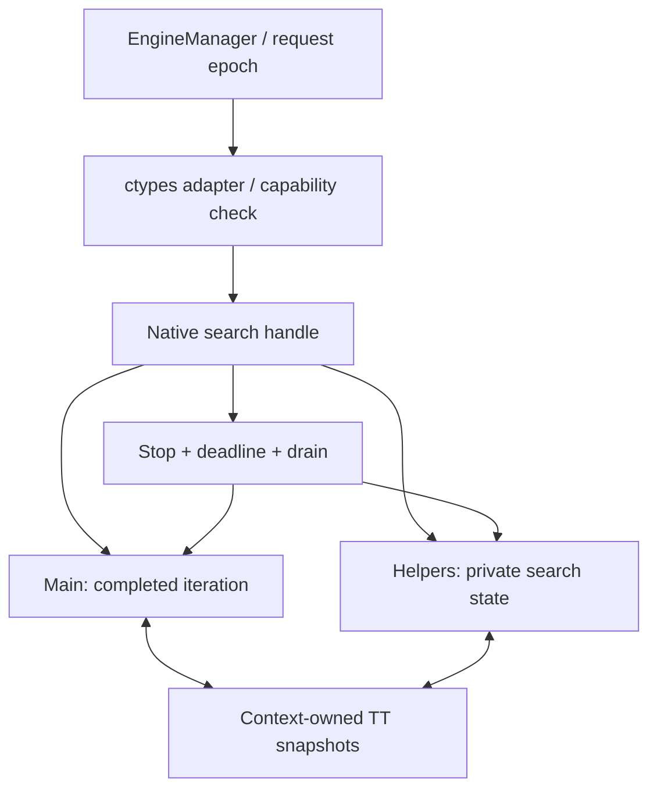

# Native Shared-TT Lazy SMP — ฉบับทบทวนการออกแบบ

วันที่ทบทวน: 2026-09-12 · Source: `e41a2469f2e5cdeb9158a36d0a511f392bac293e`

สถานะ: **PROPOSAL / CHANGES REQUIRED — ยังไม่พร้อมเปิด shared-score playing path**
ฉบับนี้ทบทวนข้อเสนอวันที่ 2026-09-11 ที่ผู้ใช้ส่งในบทสนทนา ไม่ใช่การอนุมัติ
implementation, promotion หรือเปลี่ยน production 12T โดยอัตโนมัติ
ณ commit ที่ตรวจยังไม่มีไฟล์ข้อเสนอนี้หรือ
`THREAD_SCALING_PROFILE_1T_6T_12T_TH.md` ใน Git tree จึงสร้างเอกสารฉบับทบทวนนี้
โดยแยกข้อเท็จจริงจาก source ออกจากตัวเลข profile ที่ยังไม่ได้ตรวจไฟล์ต้นฉบับ

## 1. คำตัดสินและรายการที่ต้องแก้

Lazy SMP เป็นทิศทางที่ทดลองได้ แต่คำว่า shared TT ไม่ได้แก้ correctness,
contention หรือ strength ด้วยตัวมันเอง ต้องปิดข้อ P0 ก่อนใช้ helper score ตัดกิ่ง

| ระดับ | ข้อเสนอเดิม | สิ่งที่ต้องแก้ |
|---|---|---|
| P0 | XOR verification หรือ atomic 64-bit store ทำให้ TT race-free | ต้องมี protocol ครบทั้ง entry, หลาย writer, memory ordering, lifetime และ wraparound |
| P0 | key ตรงแล้วใช้ helper bound ได้ | ต้องตรวจ king/clock identity และ repetition history ของเส้นทางที่ผลิต/ใช้ bound |
| P0 | C ABI/interface เดิมได้ 100% | ระบุ handle/API capability, NNUE binding, root candidate และ score/bound contract ตามผู้เรียกจริง |
| P0 | เพิ่มแค่ init/teardown ของ pool | ต้องออกแบบ stop, drain, reset, resize, model lifetime, error unwind และ request epoch |
| P1 | ตัด GIL/ctypes overhead ได้ 100% | CDLL ปล่อย GIL อยู่แล้ว; วัด coordinator/dispatch/marshalling ที่ลดได้จริง |
| P1 | 12T depth >= 1T เสมอ และ utilization >=8T | เปลี่ยนเป็นสถิติชุดตำแหน่งและ deadline/strength gates; ไม่ใช้ทุกตำแหน่งเป็นเงื่อนไข |
| P1 | Root-PVS เดิมล้มเพราะแชร์ alpha ผิดใน Python | แก้ให้ตรงบันทึก native bound-use parity failure และ state ของ selective search |
| P1 | เป็น SMP ใหม่จากศูนย์ | มี NativeLazySmpSearch/striped-TT/leader-only prototype เดิม; ต้องวัดกลไกใหม่ที่ต่างจริง |

## 2. หลักฐานและสมมติฐาน

ข้อเท็จจริงจาก [parallel_native.py](../../makhos/parallel_native.py): root split
แบ่งงานตาม legal root moves และยอมรับ common completed layer ก่อนเปลี่ยน depth.
ด้วย legal moves น้อยกว่าจำนวน worker อาจใช้ worker ไม่ครบ แต่ช่วง idle 30–75%,
ตัวเลข nodes/depth และ effective 3.7T ในข้อเสนอ **ยังไม่ใช่ผลที่ตรวจซ้ำในรอบนี้**.
ต้องแนบ profile ต้นฉบับพร้อม corpus/source/DLL/model SHA, time budget,
requested/effective Threads/Hash, cold/warm, repetitions และ workload isolation
ก่อนใช้ตัวเลขดังกล่าวเป็น baseline ของ candidate

[ctypes.CDLL](https://docs.python.org/3/library/ctypes.html#ctypes.CDLL)
ปล่อย GIL ระหว่างเรียก C อยู่แล้ว และ [native.py](../../makhos/native.py) ใช้ CDLL.
single search call ลดการประสานงาน/แปลงข้อมูลหลายครั้งได้ แต่ Python validation,
queue/lock wait, setup, marshalling และ response ยังมีอยู่ ต้องวัดแยกกัน

Hypothesis ที่ตรวจหักล้างได้: native workers ที่มี private search state และ
shared TT ที่อ่านได้อย่างปลอดภัย จะช่วย authoritative main ได้มากกว่าต้นทุน
งานซ้ำ/แย่ง cache/ประสานงาน เมื่อเทียบกับ baseline ที่แก้ TT identity แล้ว
ไม่ได้ตั้งสมมติฐานว่า busy threads, NPS หรือ nominal depth ที่มากขึ้นแปลว่า Elo เพิ่ม
ตำแหน่งมีตาเดียวหรือผล terminal ควรคืนผลเร็ว ไม่ต้องปลุก 12T เพื่อให้ utilization สูง

## 3. บทเรียนที่ห้ามข้าม

[Evidence ledger](../../.agents/skills/thai-makhos-engine/references/experiment-evidence-ledger.md)
บันทึก striped shared TT ว่าติด contention ที่ 8–12T และผล paired screen
กลับทิศตาม time control; try-lock รุ่นถัดมายังมี leader/root instability
(ตาที่ต้องการใน fixture ปรากฏเพียง 4/10 fresh 1s trials) จึงไม่รับเข้า production

Source ยังมี `MAKHOS_SHARED_TT`, `MAKHOS_NATIVE_LAZY_SMP`,
`makhos_lazy_smp_*` และ `NativeLazySmpSearch` แบบ default-off:
TT entry ปัจจุบัน 40 bytes, 4,096 lock stripes, private workers,
สร้าง Win32 threads ต่อ run และคืน completed result ของ worker 0.
ดังนั้น “private workers + shared TT + leader result” อย่างเดียวไม่ใช่กลไกใหม่
ต้องวัด contention, duplicate work และ helper contribution บน NNUE baseline ใหม่
เพื่ออธิบายเหตุผลของการลองครั้งต่อไป ห้ามเปิด prototype เดิมด้วยการเปลี่ยนชื่อ

[Root-PVS rejection §21](../../NATIVE_ROOT_PVS_SMP_ROADMAP_TH.md#212-สิ่งที่-reject)
ระบุว่าแม้ helper bound conservative ขึ้น การข้าม subtree ทำให้ main ไม่ได้รับ
history/killer/TT updates และเปลี่ยนผล selective search iteration ต่อไป จึงตก
predeclared parity gate ไม่ใช่หลักฐานว่าเพียงไม่แชร์ alpha โดยตรงแล้วจะปลอดภัย
Lazy SMP เป็น strength-changing experiment; >1T ไม่สัญญา node/PV parity กับ 1T

TT identity repair เป็นงานแยก: OR-salting ลบ king/clock bits; strict XOR
แก้ deterministic alias แต่ไม่ใช่ XOR checksum สำหรับ concurrency และไม่แก้
history-dependent score reuse ทั้งหมด ห้ามปนการแก้ identity กับ SMP ในการวัดผล

## 4. Ownership, routing และผลลัพธ์

- TT เป็นของ search handle/pool เดียว ไม่เป็น global ระหว่างเกม/profile/arena
  ที่ไม่มี namespace binding. Shared model weights ต้อง immutable และถูก pin
  จนทุก worker จบ; stacks, PV, history/killer, repetition path และ NNUE
  accumulators/refresh state เป็น private ต่อ worker
- Pool ใช้ซ้ำระหว่างตา, สร้างหลัง GUI พร้อมหรือเมื่อจำเป็น ไม่สร้าง threads ใหม่
  ทุก iteration; ไม่เพิ่ม startup wait. Root/history snapshot คัดลอกและตรึงตลอด run
- Phase นี้เปลี่ยน ordinary native middlegame search เท่านั้น C4 endgame routing,
  WDL intervals, `_choose`, BEST/WIN, proof precedence และ TB mmap lifetime คงเดิม
  ห้ามนำ raw TB WIN มาเป็น repetition-safe score ใน ordinary shared TT
- Thread 0 เป็นผู้ส่งผลใน proposal นี้ โดยคืน iteration ที่จบครบและ PV ที่ถูกกติกา
  helper depth สูงกว่าไม่ได้ทำให้ main result depth สูงขึ้น และไม่มี voting/
  deepest-worker election แอบเพิ่มเข้ามา หาก leader-only ยังไม่คุ้มให้หยุดและ
  review กลไกใหม่ ไม่เพิ่มผลเลือกจาก helper ระหว่างการทดลองเดิม
- เริ่ม diversification เพียงกฎเดียวที่ตรึงตาม worker ID; เก็บ seed/rule ใน manifest
  เลือกจาก profile ไม่เพิ่มทั้ง depth perturbation, random ordering และ pruning ใหม่
  ใน candidate เดียว Helpers มี deadline เดียวกันและห้าม publish node ที่ยังไม่จบ

`makhos_search_run` ปัจจุบันรับ `NativeSearchContext*` ไม่มี threads argument;
Lazy SMP ใช้ opaque handle และ `makhos_lazy_smp_*` อีกชุดหนึ่ง จึงห้ามส่ง handle
คนละชนิดเข้าฟังก์ชันเดิม ต้อง audit/reuse API เดิมพร้อม capability/version check
และกำหนด NNUE model bind ให้ครบทุก worker (adapter Lazy SMP เดิมยังไม่มี
`nnue_model` argument). เก็บ compatibility ผ่าน adapter ไม่เพิ่ม backend ถาวรซ้ำ

ต้องทำ caller/field matrix ก่อน integration: legal fallback, score convention,
PV, completed depth, nodes (main/aggregate), requested/effective threads,
TT bytes/total memory และ root candidates. Root-PVS ให้ bound ของ non-PV moves
ได้ ไม่ใช่ exact score ทุกตาโดยอัตโนมัติ หากผู้เรียกต้องการ candidates ครบ/common
layer ต้องรักษาสัญญานั้นจริง หรือทำ API migration แยกที่ผ่าน regression
ห้ามเติม helper maximum depth หรือคะแนนไม่ครบแล้วอ้าง interface เดิม 100%

## 5. Shared TT: publication และ semantic validity เป็นคนละ gate

### 5.1 Protocol ที่ต้องพิสูจน์ก่อนใช้

Aligned 64-bit atomic key ไม่ทำให้ score/depth/move ของ entry 40 bytes
เป็น snapshot เดียวกัน และ XOR check ไม่ทำให้ plain concurrent reads/writes
ถูกต้องตามภาษา C. การเข้าถึงที่เกิด data race มี undefined behavior ตาม
[C memory model §5.1.2.4](https://www.open-std.org/jtc1/sc22/wg14/www/docs/n1570.pdf).
[Windows atomicity documentation](https://learn.microsoft.com/en-us/windows/win32/sync/interlocked-variable-access)
ก็แยก atomicity ของตัวแปรหนึ่งตัวออกจาก synchronization.

แนวทางอ้างอิงสำหรับ review protocol: per-entry sequence counter และ payload
ทุก word เป็น `_Atomic uint64_t`, เริ่มด้วย sequentially consistent accesses
ทั้งชุดเพื่อให้ตรวจ interleaving ได้ง่าย ก่อน optimize memory ordering แยกงาน

1. Writer ทำ CAS sequence จาก even เป็น odd เพียงครั้งเดียว; แพ้แล้ว skip store
2. Writer ที่ได้สิทธิ์เขียน key/score/depth/bound/move/context tag เป็น atomic words
   แล้ว publish sequence even ค่าใหม่. ไม่ใช้ memcpy/struct access บน atomic storage
3. Reader อ่าน sequence, payload words, sequence อีกครั้ง; odd/ต่างกันเป็น TT miss
   รับเฉพาะ even ค่าเดียวกัน ไม่มี retry loop ที่ทำให้รอ writer ไม่จำกัด
4. ไม่ clear/resize/free หรือ atomic_init ขณะ worker ยังเข้าถึงอยู่; ผูก run epoch
   และป้องกัน counter wrap/ABA ด้วยการ drain ก่อน reset. generation 8-bit เดิม
   ไม่ใช่ sequence counter. ต้องตรวจ alignment, atomic_is_lock_free และ sizeof จริง

นี่เป็น **reference protocol ที่ยังต้องพิสูจน์/วัด** ไม่ใช่ performance result
และไม่เรียก lock-free โดยอัตโนมัติ: writer ยังถือสิทธิ์ต่อ entry และ atomic type
อาจใช้ lock ในบาง target. หาก primitive ไม่ตรง capability ให้ fail ชัดเจน
writer ที่ถูกพักทำให้ entry นั้นใช้ไม่ได้ชั่วคราว แต่ search ต้องเดินต่อได้

ตัวแยกจาก prototype เดิมคือขอบเขต contention ต่อ entry และ atomic snapshot
ไม่ใช่ stripe 4,096 ช่อง แต่ยังต้องพิสูจน์ว่าดีกว่าเก่าจริง การลด memory order,
packing ใหม่ หรือผลเลือกจาก helper เป็นการทดลองถัดไป ไม่เพิ่มกลาง gate เดิม

### 5.2 เมื่อใดจึงใช้ score ตัดกิ่งได้

Atomic snapshot ผ่านไม่ได้แปลว่า bound ใช้กับ search context ปัจจุบันได้:

- TT identity ต้องรวม board, king mask, side และ reversible clock อย่างไม่ลบ bits
- score/depth/bound ต้องมาจาก completed node ที่มี semantics เดียวกัน; normalize
  mate distance ตาม ply และแยก score จาก exact WDL/proof
- binding ต้องครอบคลุม rules/no-progress/repetition policy, model/evaluator identity
  และ history ที่มีผลต่อ repetition; root history เดียวกันยังมี in-line paths ต่างกัน
- guard เดิม `repetition_count <= 1` และ `clock + depth < limit` ยังไม่ใช่ proof
  ว่า history อื่นไม่มีผลใน subtree. Search epoch หรือ board hash อย่างเดียวไม่พอ

**P0 ที่ยังเปิด:** นิยามและพิสูจน์ `score_admissible(entry, context)` ให้ชัด
ว่าจะใช้ exact compatible history context หรือ conservative restriction ใด
พร้อม oracle counterexamples; ห้ามถือว่าใส่ history hash หนึ่งตัวเท่ากับพิสูจน์แล้ว
ก่อนปิด P0 นี้ shared entries ใช้ได้เพียง legal-validated move hints ใน diagnostic
เท่านั้น ไม่เปิด shared-score playing path. ไม่เพิ่ม move-only เป็น production
backend ถาวรอีกตัว และไม่เรียกผล diagnostic ว่า Lazy SMP strength สำเร็จแล้ว

### 5.3 Budget และ telemetry

Hash 512 MiB เป็นงบ TT รวมของ handle ไม่ใช่ต่อ worker; หาก diagnostic ยังใช้
private TT ด้วยต้องรวมในงบเดียวกัน. Sequence/context metadata และ alignment
อาจเพิ่ม entry size จึงห้ามคงเลข 40 bytes ใน Python โดยสมมติ บันทึก actual bytes,
capacity, private stacks/accumulators, pool memory, RSS/peak และ allocation failures

เก็บ main/worker nodes, completed depth, duplicate probes, snapshot rejects,
CAS/store skips, helper-written entries ที่ main ใช้จริง และ main cutoff contribution
ใน diagnostic build. ตรวจ instrumentation parity ก่อนใช้ตัวเลข; ไม่ปนเวลา
instrumented กับ performance runs และไม่อ้าง causal benefit จาก hit count อย่างเดียว

## 6. Lifecycle และเวลา

ลำดับของ handle: IDLE → RUNNING → STOPPING → IDLE; destroy จาก IDLE เท่านั้น
request มี epoch ใหม่, root/history/config snapshot, deadline แบบ monotonic เดียวกัน
นับ setup/wake/search/stop/join ตามสัญญาเวลาที่ประกาศ ไม่เริ่ม budget ใหม่ให้ helper

Cancel/new game/model change/resize/shutdown ต้องตั้ง stop, wake sleeping workers,
รอ drain แล้วจึง reset/free. ผลจาก epoch เก่าห้ามย้อนกลับเข้า GUI. `close` ซ้ำต้อง
ปลอดภัย; create/wake/thread-allocation failure ต้อง unwind handles และ model refs
ครบ ไม่ใช้ TerminateThread และไม่ปล่อย thread เข้าถึง Python-owned buffer หลังคืน C

ระบุ polling bound และวัด stop-to-drain latency ด้วย ไม่แก้ overshoot โดยคืนผลแล้ว
ปล่อย workers วิ่งข้ามเกม. ถ้าตั้ง worker ได้ไม่ครบให้คืน error หรือ fallback ที่ประกาศ
และบันทึก effective threads จริง ห้ามนับเป็น run 12T. ไม่มี barrier ทุก depth
ไม่ได้หมายความว่าไม่มี startup/completion synchronization หรือ straggler ตอน stop

## 7. Gates ที่แก้แล้ว

| Gate | หลักฐาน/เงื่อนไข |
|---|---|
| G0: Freeze | แนบ profile ต้นฉบับ; ตรึง strict-key control, compiler/model/config/corpus SHA, protocol และ tolerance ก่อนเปิด candidate |
| G1: 1T | ไม่ปลุก helpers; move/score/PV/nodes/completed depth ตรง **same-source strict 1T** ที่ fixed depth และ history/TT state เดียวกัน; timed nodes ไม่บังคับ bit-exact; วัด overhead แยก |
| G2: TT correctness | key aliases, forced same-entry multi-writer interleavings, partial publication, writer paused, ABA/generation, clear/resize; race detector ใน harness ที่รองรับและ Windows target tests; ปิด score-admissibility P0 |
| G3: Search/lifecycle | legal moves/PV, independent low-depth oracle, history H1→H2→H1/long cycles, clock 79/80, multi-capture/promotion, terminal/proof precedence, timeout/cancel/restart, repeated games, allocation failure, leaked handles/memory |
| G4: Runtime/scaling | held-out diverse suite ที่ 1/2/4/**6**/8/12T, 1s/2s, repeats, cold/warm, BelowNormal/isolation; main depth distribution, per-position regressions, CPU, TT contribution, memory, deadline and stop latency |
| G5: Strength | fresh paired color-swapped pentanomial; intrinsic 1T ตามโครงการ แล้ว 12T production 1s/2s แยก seed/output; ตรึง H0/H1/alpha/beta/cap ก่อน launch; INCONCLUSIVE ไม่ promote |
| G6: Production | full current suite, perft/differential เมื่อ native state เปลี่ยน, NNUE parity, TB4–6 และ NNUE/HCE GUI smoke/rollback บน Windows |

500 random positions เป็น smoke ส่วนหนึ่ง ไม่ใช่หลักฐานไม่มี race/deadlock/leak
ต้องมี directed interleavings และ deterministic seeds สำหรับการทำซ้ำด้วย
>1T ไม่บังคับ exact PV/nodes ข้าม schedule; ตรวจ legality, score semantics,
completed-result contract และ oracle cases แทน ส่วน 1T parity ยังเข้มเหมือนเดิม

ยกเลิก “12T depth >= 1T เสมอ”: selective search, move ordering และ timing ทำให้
nominal depth เทียบตรงทุกตำแหน่งไม่ได้. ใช้ distribution/paired per-position
ผลเวลาพร้อม strength และไม่ยอมให้ latency/1T cost เสื่อมเกิน tolerance ที่ตรึงไว้
ก่อนรัน. CPU >=8T เป็น diagnostic target เฉพาะงานค้นที่มีเวลาพอ ไม่ใช่ acceptance
criterion และไม่ให้การใช้ CPU สูงชดเชย Elo ที่ลดลง

## 8. ลำดับงานและ complexity

1. ปิด TT identity acceptance และ profile บน baseline ใหม่ แยกจาก SMP
2. ปิด publication/score-admissibility/caller-contract P0 และ review lifecycle
3. จึงสร้าง isolated candidate ด้วย existing build orchestrator/API ownership;
   เริ่ม protocol harness/1T แล้ว scaling และ paired strength ตาม gates

ใช้หนึ่ง runtime selection สำหรับ candidate เมื่อได้รับอนุมัติ ไม่เพิ่ม
NNUE variants, mutable state owners หรือ entrypoints ซ้ำ. มี native pool owner
เพิ่มขึ้นจริงและ platform synchronization dependency แม้ไม่มี external library
จึงต้องบันทึกใน complexity assessment. Production 12T/C4 และ stopped SPRT
checkpoints คงเดิม; ข้อยกเว้น strength ของ PR #6 ไม่ครอบคลุมงานนี้

จุดที่ต้องตัดสินใจให้เสร็จก่อน implementation คือ **score-admissibility proof,
complete root/API contract และ profile ที่ผูก source/artifacts**. เอกสารนี้ยังไม่
อนุญาตให้ข้ามสามเรื่องนั้นเพียงเพราะเลือกชื่อสถาปัตยกรรม Lazy SMP แล้ว
