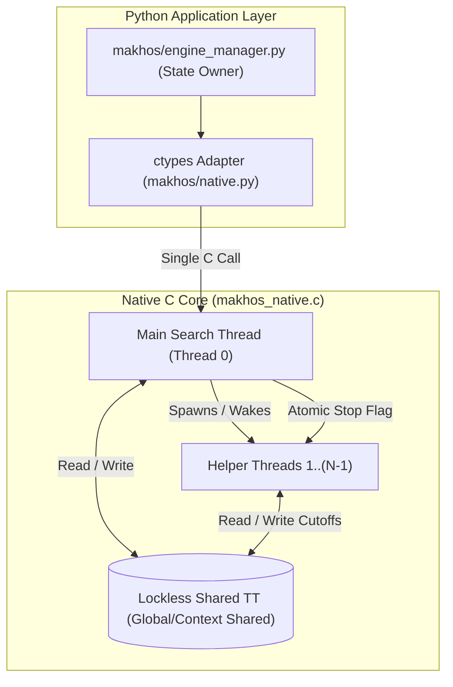

# เอกสารข้อเสนอการออกแบบ SMP: Native Shared-TT Lazy SMP

> **SUPERSEDED — historical proposal, not implementation authority (2026-09-14).**
> ใช้ [NATIVE_SHARED_TT_LAZY_SMP_DESIGN_TH.md](NATIVE_SHARED_TT_LAZY_SMP_DESIGN_TH.md)
> และ [current-state](../../.agents/skills/thai-makhos-engine/references/current-state.md)
> สำหรับขอบเขตปัจจุบัน: move hints only; shared-score cutoff ยัง BLOCKED
> เก็บข้อเสนอเดิมด้านล่างเพื่อประวัติ ไม่ใช้สมมติฐานหรือคำสั่ง launch เดิมข้าม gates

บันทึก ณ วันที่: 2026-09-11  
สถานะ: **PROPOSAL (รอการตรวจทานและอนุมัติจาก User ก่อนเริ่ม Implementation)**  
ผู้เสนอ: Antigravity Assistant  
อ้างอิงหลักฐาน: [THREAD_SCALING_PROFILE_1T_6T_12T_TH.md](../benchmarks/THREAD_SCALING_PROFILE_1T_6T_12T_TH.md)

---

## 1. ที่มาและปัญหาที่ต้องแก้ไข (Motivation & Problem Statement)

จากการ Profile การทำงานแบบ Multi-thread (1T..12T) บนเครื่อง AMD Ryzen 5 5600H (6 Cores / 12 Threads) ใน Step 3 พบข้อเท็จจริงเชิงประจักษ์ 5 ประการ:

1. **Branch Starvation**: หมากฮอสไทยมีตาเดินเฉลี่ยเพียง 4–8 ตาเดิน ทำให้ Root Split ในปัจจุบันทิ้งให้ Worker ว่างงานถึง 30%–75% เมื่อตั้งค่า 12 Threads
2. **Slowest-Branch Barrier**: Worker ทั้งหมดต้องรอที่ Barrier จนกว่ากิ่งที่ช้าที่สุดจะเสร็จที่ Depth D ก่อนจึงเริ่ม Depth D+1 ได้
3. **Depth Reached Paradox**: 12T ทำงานไปถึง 10.9M–12.6M nodes แต่ไปถึงได้เพียง Depth 17–19 ในขณะที่ 1T ใช้เพียง 3.8M–4.0M nodes แต่ไปถึง Depth 18–20 ได้ เนื่องจาก 1T ใช้ PVS Pruning อย่างเต็มประสิทธิภาพ ขณะที่ Root Split ขาดการแชร์ข้อมูล Alpha/Beta ระหว่างกิ่ง
4. **Python Coordinator Overhead**: การกระจายงานข้าม Python `ThreadPoolExecutor` และ ctypes สร้าง Latency คงที่สูง
5. **ข้อจำกัดเดิมที่ไม่ให้ย้อนกลับ**: โครงการเคยปฏิเสธ Root-PVS ในระดับ Python เนื่องจากเกิด Bound Failure จากการแชร์ Bound แบบไม่เป็นระเบียบ

เพื่อแก้ปัญหาทั้ง 5 ประการนี้ ขอเสนอแนวทางสถาปัตยกรรมแบบ **Native Shared-TT Lazy SMP** เพียงแนวทางเดียว

---

## 2. โครงสร้างสถาปัตยกรรมที่เสนอ (Proposed Architecture)

### 2.1 หลักการทำงานของ Lazy SMP
1. **Shared Transposition Table (Lockless TT)**:
   - ใช้ Transposition Table กลางร่วมกันระหว่างทุกเธรดในหน่วยความจำ C
   - การเขียนทับ (Write) และการอ่าน (Read) ออกแบบให้เป็น Lockless โดยใช้ XOR key verification หรือ 64-bit atomic store เพื่อไม่ให้เกิด Data race หรือการล็อคที่ทำให้เธรดหยุดชะงัก
2. **Search Diversification (การกระจายการค้นหา)**:
   - **Thread 0 (Main Thread)**: รันการค้นหา Iterative Deepening แบบ Alpha-Beta / PVS ตามปกติ (Depth 1, 2, 3, ...) โดยมีหน้าที่ควบคุมงบเวลาและส่งคืน Best Move / Score / PV
   - **Helper Threads (Threads 1..N-1)**: ค้นหาจาก Root เดียวกัน แต่เริ่มค้นหาด้วย Depth Perturbation หรือความลึกเหลื่อมกันเล็กน้อย (เช่น Helper 1 ค้นหา Depth D, Helper 2 ค้นหา Depth D+1 ด้วยรูปแบบ move ordering ที่เบี่ยงเบนเล็กน้อย)
   - เมื่อ Helper Thread ใดพบ Refutation Move หรือ Beta Cutoff ข้อมูลจะถูกบันทึกลง Shared TT ทันที
   - Main Thread เมื่อลงไปค้นใน Subtree เดียวกัน จะได้รับ Cutoff ทันที หรือได้ Best Move จาก TT ไปเรียงลำดับเป็นตาแรก (Move Ordering ยอดเยี่ยม) ทำให้ Main Thread ค้นได้ลึกกว่า 1T อย่างมีนัยสำคัญ
3. **In-Engine Native Threading**:
   - เธรดทั้งหมดจัดการใน C ผ่าน Windows Native Threads (`CreateThread` / `WaitForSingleObject` หรือ Event Object สำหรับการ Sleep/Wake)
   - Python เรียก `makhos_search_run` เพียงครั้งเดียว และรอผลลัพธ์กลับมา จึงตัด Python GIL contention และ ctypes overhead ออกได้ 100%

---

## 3. การวิเคราะห์ความคุ้มค่าและผลต่อคอขวด (Bottleneck Resolution)

| คอขวดเดิม (Step 3) | สภาพปัจจุบัน (Root Split) | การแก้ไขด้วย Native Lazy SMP |
|---|---|---|
| **Branch Starvation** | หากมี 4 ตาเดิน 12T จะใช้ได้เพียง 4 เธรด (8 เธรดว่างงาน) | ทุก 12 เธรดทำงานพร้อมกันได้เสมอ แม้มีตาเดินถูกต้องเพียง 1 ตาเดิน |
| **Straggler Barrier** | ทุกกิ่งต้องรอบน Barrier เดียวกัน | ไม่มี Barrier ระหว่างกิ่ง ทุกเธรดค้นหาอย่างอิสระผ่าน Shared TT |
| **Depth Reached Paradox** | 12T ได้ Depth ต่ำกว่า 1T เพราะทำซ้ำซ้อน | Helper threads ช่วยป้อน Cutoff เข้า TT ทำให้ Main thread ไปได้ลึกกว่า 1T |
| **Python GIL Overhead** | ใช้ Python `ThreadPoolExecutor` | เธรดทั้งหมดรันใน C ล้วน ไม่แตะต้อง Python runtime ระหว่างค้นหา |
| **Bound Failure Risk** | Bound คอร์รัปต์จากการแชร์ค่า Alpha นอกอัลกอริทึม | อัลกอริทึม PVS คงเดิม ไม่มีการแชร์ Alpha bound ข้ามแบบผิดกติกา |

---

## 4. การควบคุมความซับซ้อนตามเกณฑ์ `SKILL.md` (Complexity Control)

1. **Supported Profiles**:
   - รองรับ `threads` ตั้งแต่ 1 ถึง 12
   - ที่ `threads=1`: Helper threads ไม่ถูกปลุก พฤติกรรมถอดแบบจาก Baseline 1T เดิม 100%
   - ที่ `threads=12`: ทำหน้าที่เป็น Production Default แทนที่ Python root splitter
2. **Mutable State Owners**:
   - ผู้ดูแล State ยังคงเป็น `makhos/engine_manager.py` (ระดับ Python)
   - ฝั่ง C จัดการเธรดภายใน `makhos_search_context` โดยมี ownership ชัดเจน ไม่รั่วไหล
3. **Cross-module Dependencies**:
   - ไม่มีการเพิ่ม External Library ใหม่ (ใช้ Win32 API พื้นฐานที่มีอยู่แล้วในระบบปฏิบัติการ)
4. **Maintained Entrypoints**:
   - C ABI ของ `makhos_native.c` คงฟังก์ชันหลักเดิม เพิ่มเฉพาะ initialization/teardown ของ thread pool ใน search context
   - Python CLI, GUI API และ Test Fixtures ใช้งาน interface เดิมได้ 100%

---

## 5. แผนการตรวจสอบและเกณฑ์การยอมรับ (Verification & Gates)

1. **Parity Gate ที่ Threads=1**:
   - เมื่อรันที่ `threads=1` ผลลัพธ์ Move, Score, Nodes ต้อง Bit-exact ตรงกับ Baseline 1T 100%
2. **Stress & Thread-Safety Gate**:
   - ทดสอบรัน 12 Threads ต่อเนื่อง 500 ตำแหน่งแบบสุ่ม ต้องไม่มี Crash, Deadlock, Memory Leak หรือ Data Corruption
3. **Performance Gate**:
   - ที่ 1,000 ms: Effective Depth Reached ของ 12T ต้อง **มากกว่าหรือเท่ากับ 1T เสมอ** (แก้ Depth Paradox สำเร็จ)
   - CPU Utilization ของ 12T ต้องเพิ่มขึ้นจากเดิม (จาก 3.7T ไปเป็น ≥ 8.0T บนตำแหน่งส่วนใหญ่)
4. **Paired SPRT Acceptance Gate**:
   - เมื่อผ่าน 3 Gate ข้างต้น จึงจะเปิด paired-SPRT แบบสลับสี (Pentanomial LLR) เทียบกับ Baseline เดิม เพื่อประเมิน Elo ที่เพิ่มขึ้นอย่างเป็นทางการ
